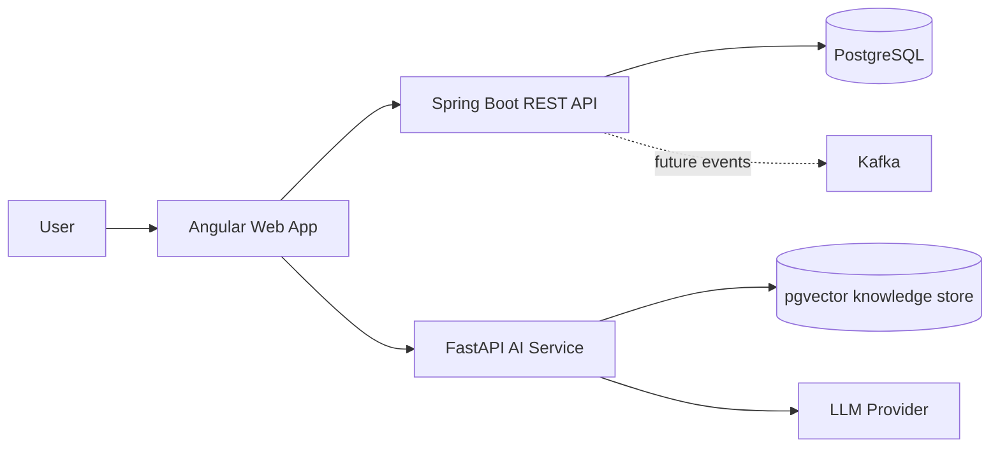

# FinSight AI — Architecture

## Goals

- Demonstrate a credible full-stack banking application.
- Keep the core transaction and account APIs deterministic and testable.
- Isolate AI capabilities behind a separate service boundary.
- Use synthetic data only.

## Logical architecture

## Components

### Angular frontend
Responsible for dashboard presentation, transaction search and filtering, analytics visualisations, and the AI assistant experience. It must not contain secrets or make privileged decisions.

### Spring Boot banking API
Owns demo accounts, transactions, categories and loan-insight endpoints. Responsibilities include request validation, business rules, persistence, consistent error responses and API documentation.

### Python AI service
Provides the AI assistant endpoint. The planned retrieval-augmented generation flow retrieves relevant passages from a curated demo knowledge base before composing an answer. Provider credentials remain server-side.

### PostgreSQL
Stores synthetic accounts, transactions and application metadata. pgvector may be enabled for document embeddings when the RAG milestone begins.

### Kafka (later milestone)
Deferred until a real asynchronous workflow is implemented, such as transaction event processing. It is not required for the first MVP.

## Initial API boundaries

- `/api/v1/health` — service health
- `/api/v1/accounts` — demo account summaries
- `/api/v1/transactions` — transaction list and filters
- `/api/v1/analytics/spending` — aggregated spending
- `/api/v1/loans/eligibility` — explainable demo estimate
- `/api/v1/assistant/chat` — AI assistant (AI service)

Exact request and response contracts will be documented as endpoints are implemented.

## Local development

Docker Compose will provide PostgreSQL for local development. Frontend, backend and AI service can initially run independently for faster feedback, then be containerised.

## Deployment shape

Deploy the frontend as a static web application and deploy API services plus PostgreSQL on a compatible host. Use managed database storage where possible. Configure secrets through the hosting provider's environment settings, never in Git.

## Quality attributes

- Clear separation of concerns
- Input validation and safe error handling
- Least-privilege access
- Automated unit and integration tests
- Health checks and structured logs
- Responsive and accessible UI
- AI responses with grounded context and an explicit demo disclaimer
